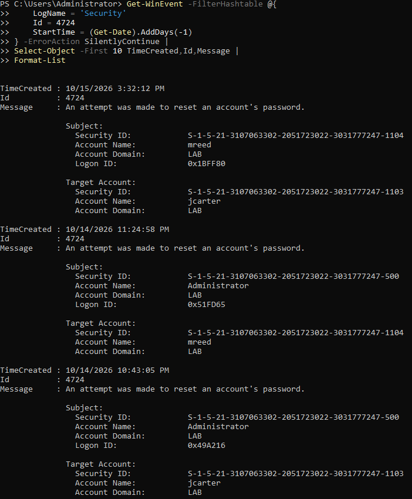
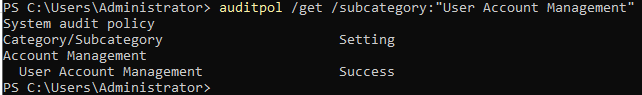

# Case Study: Active Directory RBAC, Delegated Password Reset, and Security Event 4724

**Environment:** VMware Workstation, Windows Server 2022, `DC01`  
**Domain:** `lab.local`  
**Scope:** Authorized tests against lab accounts only  
**Result:** Delegated password reset succeeded; unauthorized Domain Admins membership change was denied

## Objective

I wanted to give an IT support technician the ability to reset employee passwords without granting Domain Admin privileges. I also wanted to identify the Windows Security event that recorded the activity, so I could practice connecting an administrative action to SOC evidence.

## Accounts and group

| Object | Location | Purpose |
| --- | --- | --- |
| `jcarter` (John Carter) | `OU=Employees` | Standard employee / password-reset target |
| `mreed` (Michael Reed) | `OU=IT` | IT support technician |
| `GG_IT_Support` | `OU=Security-Groups` | Global security group for delegated permissions |

I added `mreed` to `GG_IT_Support` and verified the membership. The group was **not** added to Domain Admins.

## Delegation configuration

In **Active Directory Users and Computers**, I right-clicked the **Employees** OU and used **Delegate Control** to assign the following common task to `GG_IT_Support`:

> Reset user passwords and force password change at next logon

This delegates a narrow task on the Employees OU, rather than granting full administrative control over the domain.

## Troubleshooting: initial authentication failure

My first `Set-ADAccountPassword` test failed with an authentication error: *Either the target name is incorrect or the server has rejected the client credentials.*

I confirmed the credential username was `LAB\mreed`. I then checked Michael's account:

```powershell
Get-ADUser -Identity "mreed" -Properties Enabled,LockedOut,PasswordExpired,PasswordLastSet |
  Select-Object Name,Enabled,LockedOut,PasswordExpired,PasswordLastSet
```

The account was enabled and not locked, but `PasswordExpired` was `True` and `PasswordLastSet` was blank. The account had been created with a required password change at next logon. After changing Michael's password and refreshing the credentials, the delegated test worked.

**Lesson:** An authentication failure is not proof that delegated permissions are wrong. Check the account's password state before changing access controls.

## Positive test: authorized password reset

Using Michael's credentials, I reset John's password:

```powershell
$ITCred = Get-Credential -UserName "LAB\mreed"
$NewPassword = Read-Host "Enter John's new temporary password" -AsSecureString

Set-ADAccountPassword -Identity "jcarter" -Reset -NewPassword $NewPassword -Credential $ITCred -ErrorAction Stop
```

I verified the reset by checking `PasswordLastSet` on `jcarter`. No passwords or credential values are stored in this repository.

## Negative test: attempted privilege escalation

I tested whether the same credentials could add `mreed` to **Domain Admins**:

```powershell
Add-ADGroupMember -Identity "Domain Admins" -Members "mreed" -Credential $ITCred -ErrorAction Stop
```

The operation was **denied**. I separately verified that `mreed` was not a Domain Admin:

```powershell
Get-ADGroupMember -Identity "Domain Admins" |
  Where-Object SamAccountName -eq "mreed"
```

The membership check returned no match. This verifies the tested operation was blocked; it does not prove every possible privileged action is inaccessible.

## SOC evidence: Windows Event ID 4724

On DC01, I searched the Security log:

```powershell
Get-WinEvent -FilterHashtable @{
  LogName = 'Security'
  Id = 4724
  StartTime = (Get-Date).AddDays(-1)
} | Select-Object -First 10 TimeCreated,Id,Message | Format-List
```

I found an Event ID **4724** at **October 15, 2026, 3:32:12 PM** with:

| Event field | Value |
| --- | --- |
| Subject Account Name | `mreed` |
| Subject Account Domain | `LAB` |
| Target Account Name | `jcarter` |
| Target Account Domain | `LAB` |
| Event ID | `4724` |

Event 4724 means **an attempt was made to reset an account's password**. The event alone does not prove success; I used the successful command and account verification as supporting evidence.

I also checked the audit policy:

```powershell
auditpol /get /subcategory:"User Account Management"
```

The result was **Success** auditing for **User Account Management**. Failure auditing was not enabled for that subcategory at the time of this check, so I do not claim a failure audit event was captured for the denied Domain Admins test.

## Evidence

| Evidence | Screenshot |
| --- | --- |
| Standard employee account | [John Carter](../evidence/phase-02/phase02-11-first-employee-account.png) |
| IT support account | [Michael Reed](../evidence/phase-02/phase2-12-it-support-account.png) |
| Global security group | [GG_IT_Support](../evidence/phase-02/phase2-13-it-security-group.png) |
| Group membership | [Members tab](../evidence/phase-02/phase2-14-it-support-group-membership.png) |
| Membership verification | [PowerShell](../evidence/phase-02/phase2-15-it-support-powershell-verification.png) |
| Delegation configuration | [Delegation wizard](../evidence/phase-02/phase2-16-password-reset-delegation.png) |
| Password reset test | [PowerShell](../evidence/phase-02/phase2-17-password-reset-test.png) |
| Security event | [Event ID 4724](../evidence/phase-02/phase2-18-event-4724.png) |
| Audit configuration | [User Account Management auditing](../evidence/phase-02/phase2-19-audit-policy.png) |

### Event 4724: mreed resetting jcarter



### Audit policy



## Outcome

- Created two lab user accounts and a dedicated global security group.
- Granted password-reset permissions only on the Employees OU.
- Confirmed the delegated password reset worked after resolving a first-logon password issue.
- Confirmed an unauthorized Domain Admins membership change was denied.
- Located and interpreted Event ID 4724 and verified the relevant audit policy.

**Next:** Join a Windows client to the domain, test delegated help desk workflows from a workstation, and expand endpoint auditing and log collection.
