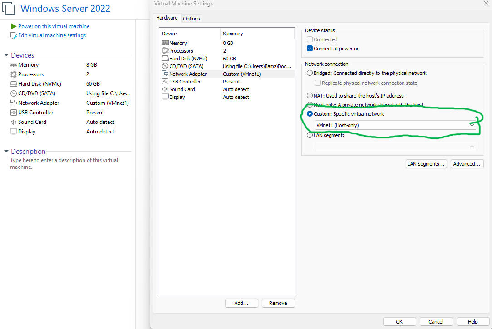
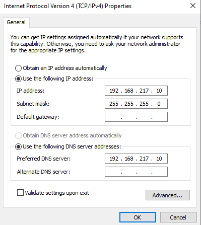
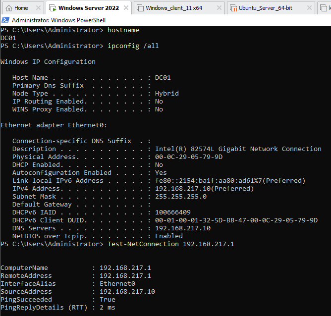
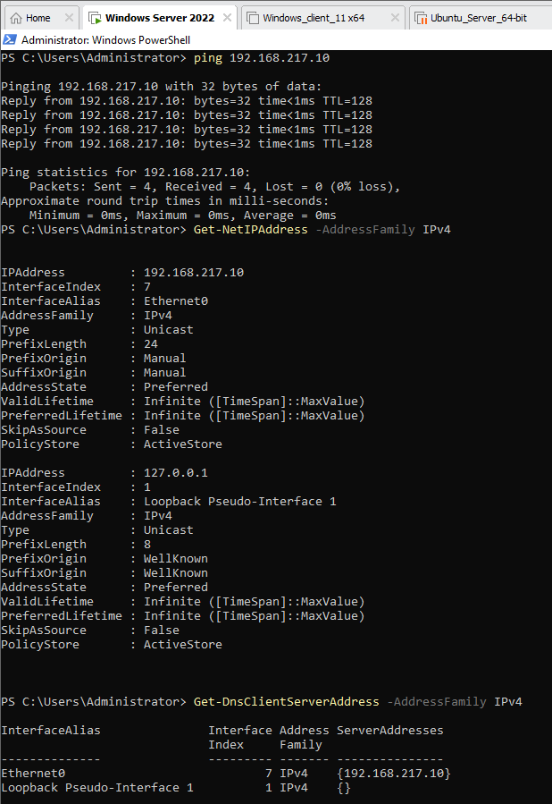
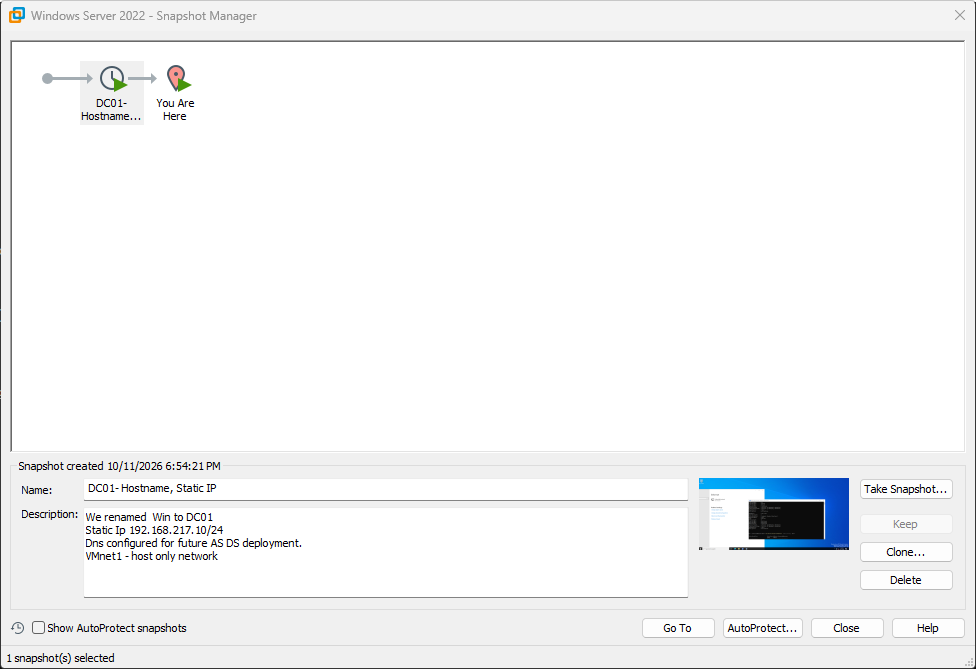

# Phase 1  Networking and getting DC01 ready

## Why I started here

Before installing Active Directory, I wanted the network to be predictable. A domain controller needs a stable address, and I didn't want my test machines mixed into my home network. I used VMware Workstation's host-only VMnet1 for the lab side.

## What I set up

- **VMnet1:** host-only network, `192.168.217.0/24`.
- **Windows Server 2022:** named `DC01` in my lab plan.
- **Static IPv4:** `192.168.217.10`, subnet `255.255.255.0`.
- **Gateway:** left blank on the host-only adapter.
- **DNS:** `192.168.217.10` in the server's IPv4 properties as preparation for its DNS role.

Setting an IP as the preferred DNS server does **not** mean Active Directory DNS is already installed or working. That's a later step.

## Checks I made

I used `ipconfig /all` to see the assigned address and DNS server, plus PowerShell connectivity checks to the VMnet1 host interface (`192.168.217.1`). My saved captures show successful connectivity in that configuration.

Example checks I can run again when I rebuild or troubleshoot:

```powershell
hostname
ipconfig /all
Get-NetIPConfiguration
Get-DnsClientServerAddress -AddressFamily IPv4
Test-NetConnection 192.168.217.1
```

## Something that went wrong

Not every test worked the first time. At one point PowerShell ping attempts failed with **`PING: transmit failed. General failure.`** while I was adjusting the Windows networking. That reminded me to verify the VM adapter and guest IP configuration before assuming the problem was Active Directory or the firewall.

I later captured successful checks. I still want to document the exact fix only after I can reproduce and explain it accurately.

## Screenshots from this stage

These are the screenshots I captured while preparing DC01. They show my configuration at the time, not proof that AD DS or DNS services are installed.

**1. VMware network adapter on VMnet1**



**2. Static IP and preferred DNS**



**3. PowerShell configuration and host connectivity**



**4. Local address ping and IPv4/DNS checks**



The ping in screenshot 4 is to DC01's own address. It confirms the local TCP/IP stack responds, but doesn't establish connectivity to another VM.

**5. Snapshot before AD DS**



**Still to capture:** Virtual Network Editor showing VMnet1 settings, plus a fresh end-to-end test to another VM after it is configured.

## Next step

Install AD DS, confirm DNS service operation, and promote DC01 to the first domain controller for `lab.local`. I'll keep the deployment screenshots and test results in the next write-up.
