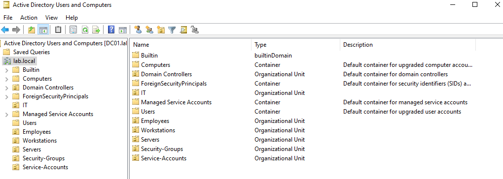
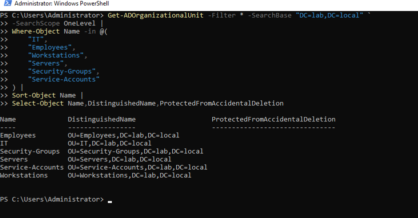

# Phase 2 — Step 4: Active Directory Organizational Unit Structure

**Environment:** Windows Server 2022, VMware Workstation Pro  
**Domain controller:** `DC01`  
**Domain:** `lab.local`  
**Status:** Six top-level OUs created and verified

## Objective

I organized the new Active Directory domain into separate Organizational Units (OUs) for people, computers, groups, and service identities. This will help me apply targeted Group Policy settings and keep future Blue Team exercises organized.

## OU structure

| OU | Intended use |
| --- | --- |
| `IT` | IT staff and administrative identities |
| `Employees` | Standard user accounts |
| `Workstations` | Domain-joined Windows client computer objects |
| `Servers` | Member server computer objects |
| `Security-Groups` | Custom role-based security groups |
| `Service-Accounts` | Dedicated application and service identities |

All six OUs are directly beneath `lab.local`. I left the default **Domain Controllers** OU unchanged; DC01 stays there rather than moving into the custom Servers OU.

## Implementation

I opened **Active Directory Users and Computers** on DC01, right-clicked the `lab.local` domain, and created each OU using **New → Organizational Unit**. I kept **Protect container from accidental deletion** enabled for every OU.

I created them in this order: IT, Employees, Workstations, Servers, Security-Groups, Service-Accounts.

## Validation

I used PowerShell to list the six top-level OUs and their distinguished names:

```powershell
Get-ADOrganizationalUnit -Filter * -SearchBase "DC=lab,DC=local" `
  -SearchScope OneLevel |
  Where-Object Name -in @(
    "IT", "Employees", "Workstations", "Servers",
    "Security-Groups", "Service-Accounts"
  ) |
  Sort-Object Name |
  Select-Object Name, DistinguishedName, ProtectedFromAccidentalDeletion
```

The output listed all six OUs with the expected distinguished names. The captured output did not visibly confirm the accidental-deletion protection property; that setting should be rechecked separately using `-Properties ProtectedFromAccidentalDeletion`. I also checked the completed OU tree in Active Directory Users and Computers.

## Evidence

I captured screenshots for each creation milestone, the completed six-OU tree, and the PowerShell validation. These files are published in the repository:

| Evidence | Screenshot |
| --- | --- |
| IT OU | [View](../evidence/phase-02/phase2-04-it-ou-created.png) |
| Employees OU | [View](../evidence/phase-02/phase2-05-employees-ou-created.png) |
| Workstations OU | [View](../evidence/phase-02/phase2-06-workstations-ou-created.png) |
| Servers OU | [View](../evidence/phase-02/phase2-07-servers-ou-created.png) |
| Security-Groups OU | [View](../evidence/phase-02/phase2-08-security-groups-ou-created.png) |
| Complete six-OU structure | [View](../evidence/phase-02/phase2-09-complete-ou-structure.png) |
| PowerShell verification | [View](../evidence/phase-02/phase2-10-ou-powershell-verification.png) |

### Final structure



### PowerShell verification



## Security notes

- An OU is a container and Group Policy targeting boundary; it does **not** grant administrative access by itself.
- This document records the initial OU build. A later milestone created `GG_IT_Support` and tested its delegated permissions; see [the RBAC case study](../case-studies/ad-rbac-delegated-password-reset.md).
- Service identities and passwords have not yet been created.
- The default Domain Controllers OU was preserved.
- The screenshots were visually reviewed for obvious secrets before publication.

## Outcome and next steps

**Completed:** Six top-level OUs created and verified by name and distinguished name. Accidental-deletion protection is pending explicit property verification.

**Next:** Place domain-joined computers in the correct OUs; apply and validate Group Policy settings. Domain Controller health troubleshooting is documented separately in [the DFSR case study](../case-studies/dfsr-initialization-warning.md).
